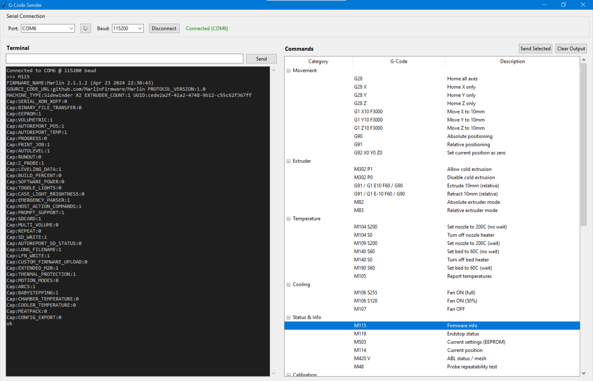

# G-Code Sender

A lightweight Python GUI for controlling a 3D printer over serial. Built with `tkinter` and `pyserial`.



## Features

- **Terminal** — type any G-code and send it, with live response display
- **Commands browser** — categorized list of common G-codes (movement, temperature, calibration, SD card, BLTouch, etc.); double-click to send
- **Serial connection** — auto-detects available COM ports, configurable baud rate

## Requirements

- Python 3.10+
- `pyserial`

Install dependencies:

```
pip install pyserial
```

## Usage

```
python gcode_sender.py
```

Select the printer's COM port and baud rate (typically `115200`), click **Connect**, then use the terminal or commands panel to send G-code.
